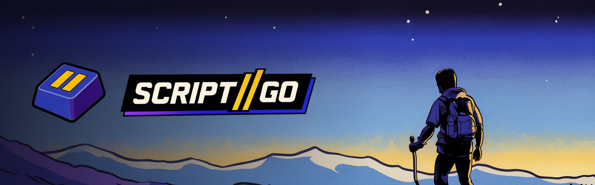
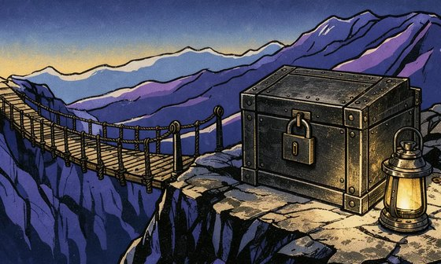
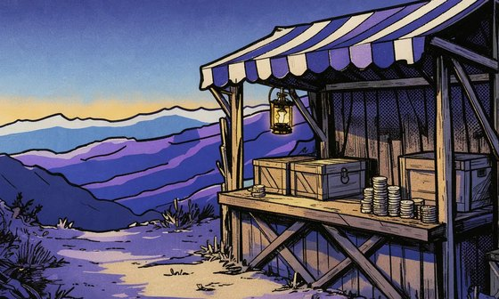

<h3 align="center">One script. Every world.</h3>

SCRIPT//GO is a scripting sandbox for the games you run. 
Write a script once, run it on many platforms, protect it, and license or sell it.

<table>
<tr>
<td width="33%" valign="top">
 
<b>Run anywhere</b> 
A portable Lua core and one adapter per platform: game servers, engines and mod platforms. TypeScript and JavaScript on the .NET host.
</td>
<td width="33%" valign="top">
 
<b>Protect your work</b> 
Server code encrypted at rest, a key released per server, revocation, and traceable deliveries.
</td>
<td width="33%" valign="top">
 
<b>License or sell it</b> 
Sell from your own Tebex store, grant free licences, or sell perks to the players of your servers.
</td>
</tr>
</table>

### Repositories

| Repository | |
|---|---|
| `scriptgo` | The platform: API, website, worker |
| `scriptgo-sdk` | The SDK: runtime, adapters, CLI, protected-release loader, guides |

Both are private while SCRIPT//GO is in development. The SDK will open once its licence is chosen.

### Status

In development, private beta not started. Game, engine and provider names are trademarks of their
owners; no endorsement is implied.
